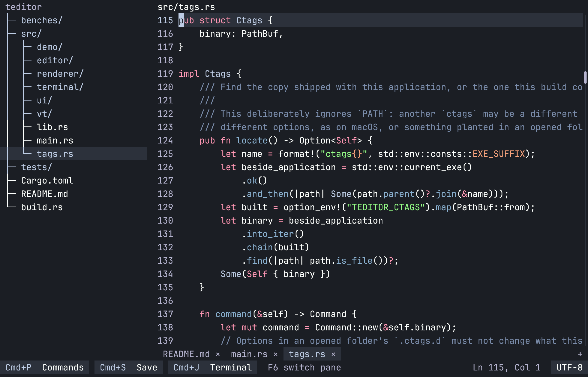
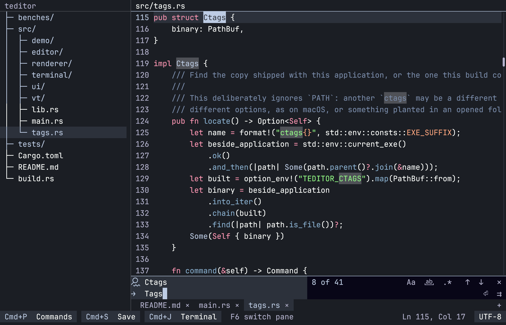
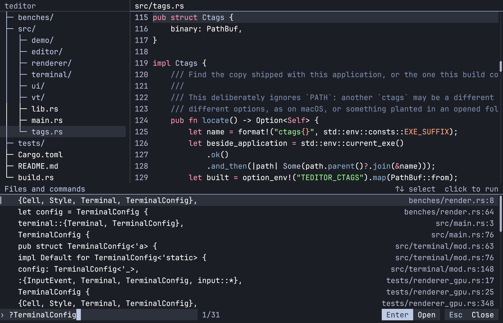
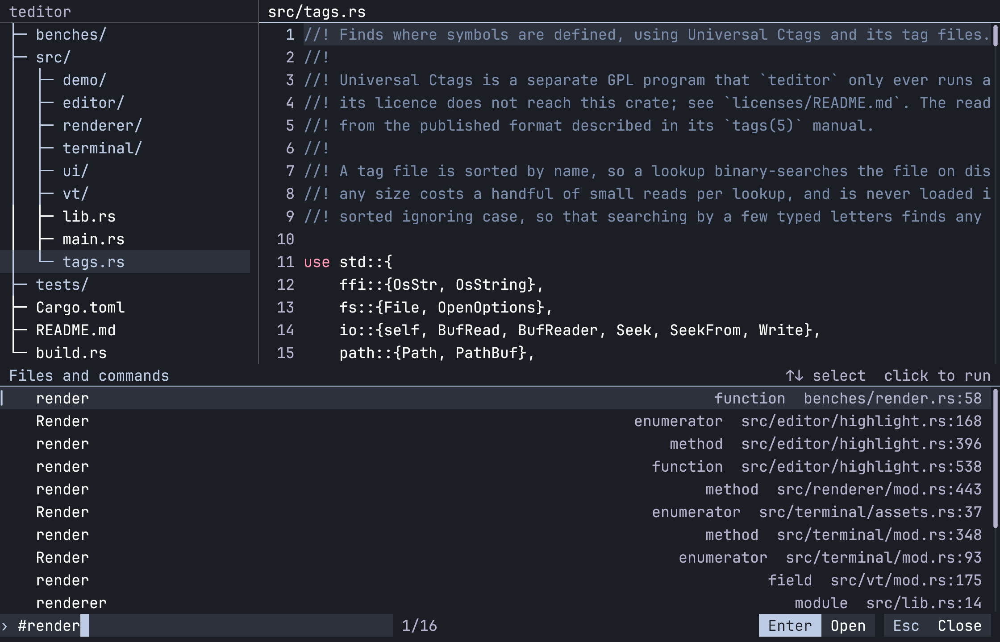
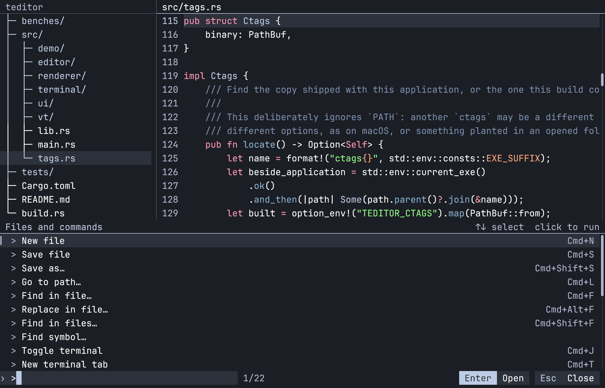
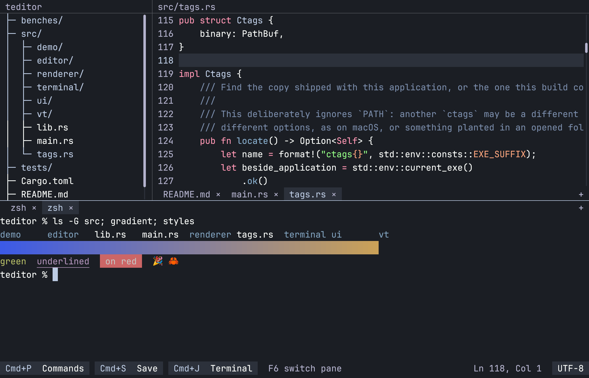
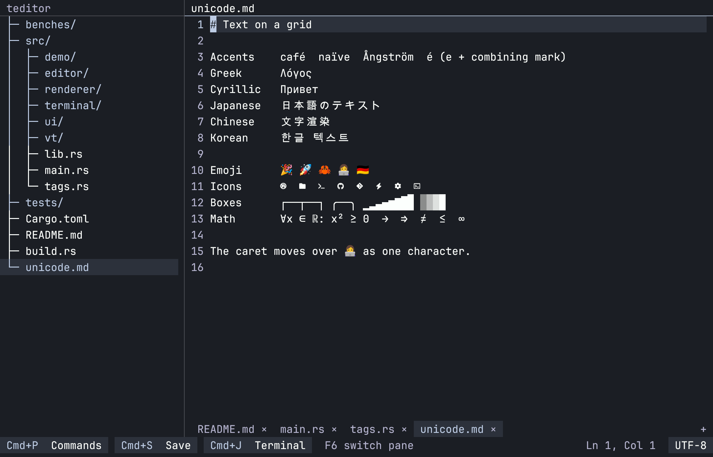

# teditor
> Since nowadays most code editors are slop, I vibecoded my own

A text editor that looks like a terminal program but has first-class mouse support, drawn on a
fixed cell grid by its own GPU renderer.

- **Files larger than your RAM.** Open, edit, undo and save them while memory follows what is on screen, not the file's size.
- **Mouse and keyboard, equally.** Every button names its shortcut, and panes resize by dragging.
- **One palette.** Files, commands, symbols and workspace search, all behind Cmd+P.
- **Find and replace.** Regex, capture groups and whole-word matching, with search that never blocks typing.
- **Find in files.** Built on the crates behind ripgrep, and respects `.gitignore`.
- **Go to definition, no language server.** Cmd+click uses Universal Ctags, and asks the Rust compiler when a nightly toolchain is installed.
- **A real terminal.** Tabbed shells powered by libghostty-vt, with true color, scrollback and the Kitty keyboard protocol.
- **Live files.** Logs follow the disk as they grow, and the file tree updates itself.
- **Any encoding.** Detects and converts legacy encodings, and keeps line endings, byte-order marks and raw bytes intact.
- **Text done properly.** Color emoji, CJK, grapheme clusters, IME input, Nerd Font icons and instant word wrap on enormous lines.
- **No flicker.** Only changed cells repaint, and every frame is presented complete.

<table>
  <tr>
    <td></td>
    <td></td>
  </tr>
  <tr>
    <td></td>
    <td></td>
  </tr>
  <tr>
    <td></td>
    <td></td>
  </tr>
</table>

## Third-party code

- [libghostty-vt](https://github.com/ghostty-org/ghostty) runs the terminal panel.
- [Universal Ctags](https://ctags.io/) finds symbols. It is a GPL program that `teditor` runs separately.
- [ripgrep's libraries](https://github.com/BurntSushi/ripgrep) power text search.
- [syntect](https://github.com/trishume/syntect) highlights syntax, using grammars from [two-face](https://codeberg.org/CosmicHarper/two-face) and the [bat](https://github.com/sharkdp/bat) project.
- [HarfRust](https://github.com/harfbuzz/harfrust) shapes text.
- WezTerm's `portable-pty` is the basis of the Windows pseudo-console code.
- [JetBrains Mono](https://github.com/JetBrains/JetBrainsMono), [Noto Color Emoji](https://github.com/googlefonts/noto-emoji) and [Nerd Fonts](https://github.com/ryanoasis/nerd-fonts) are embedded fonts.

See [`licenses/README.md`](licenses/README.md) and `assets/fonts/` for licenses.
