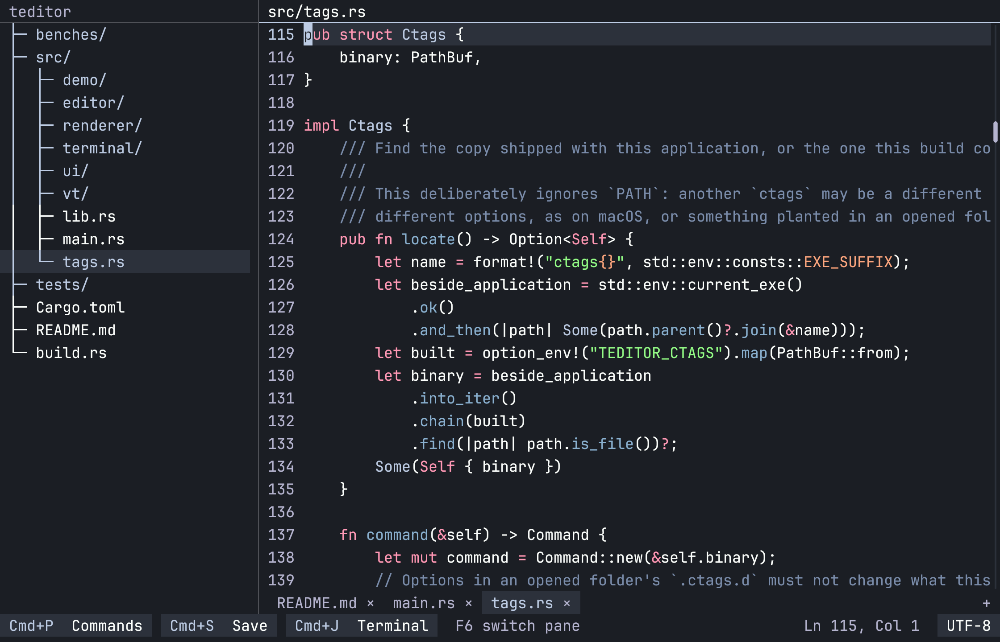
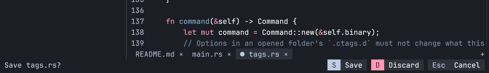
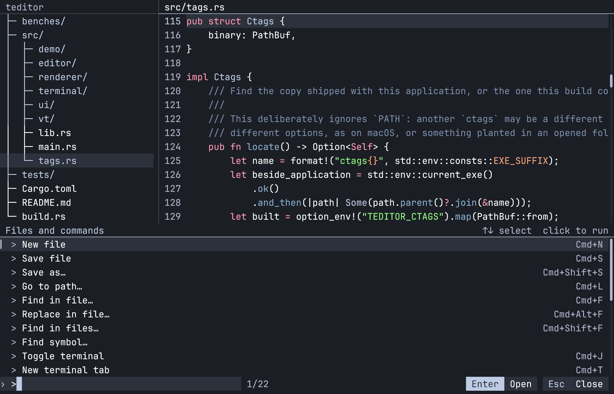
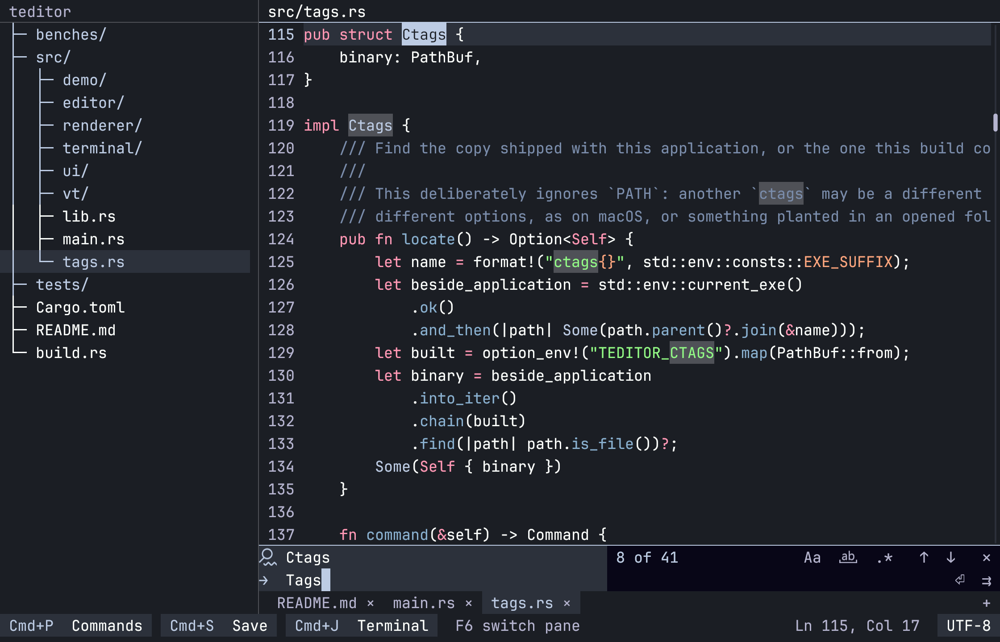
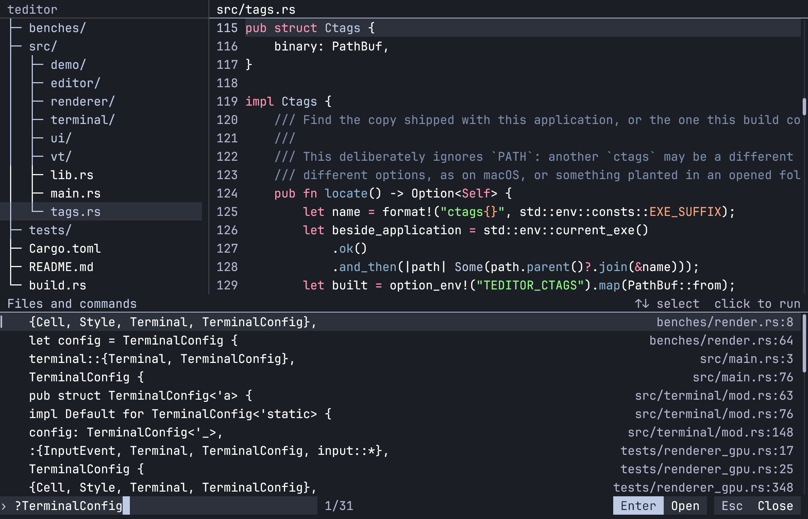
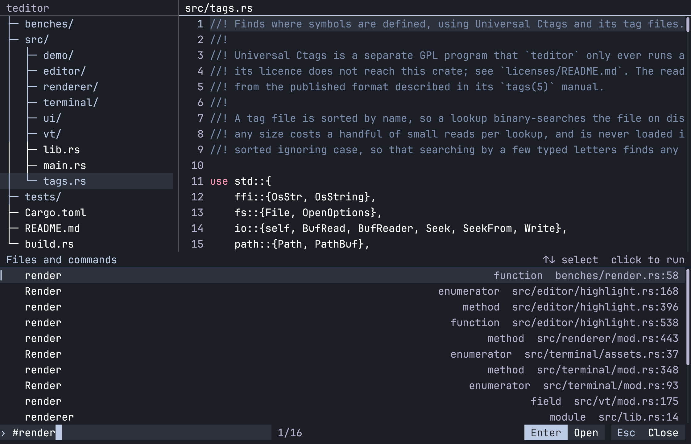
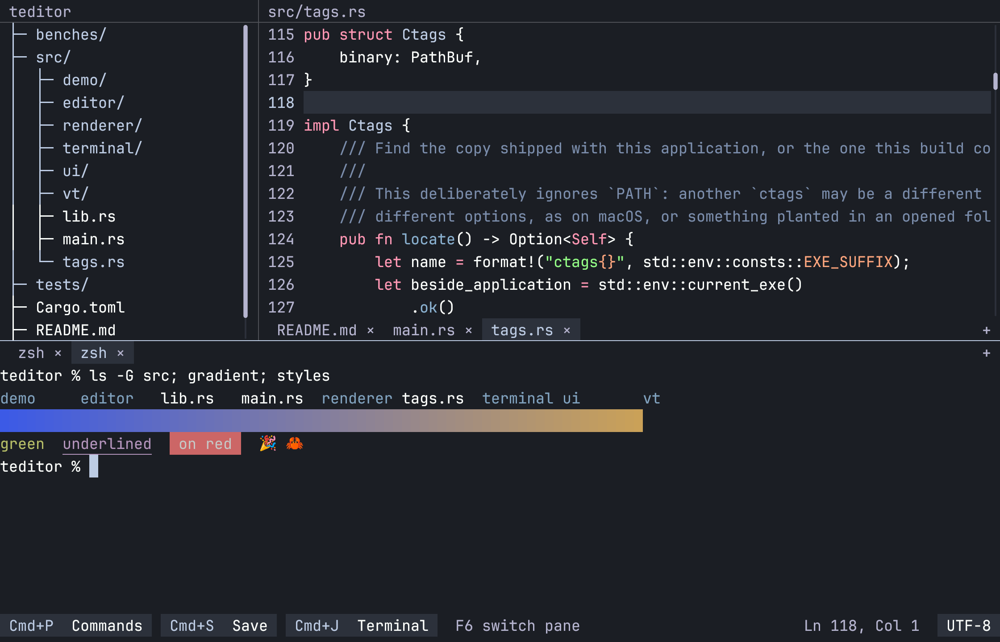
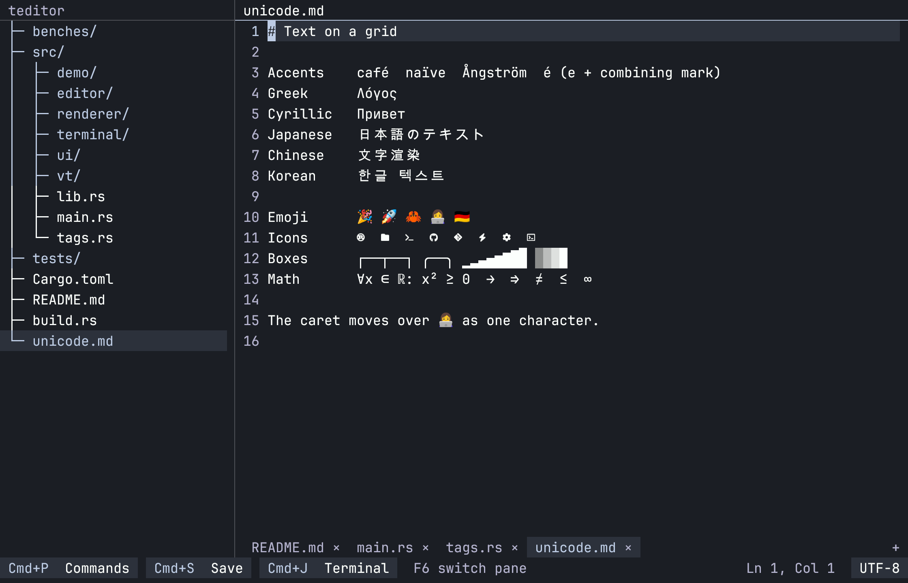

# teditor guide

A text editor that looks like a terminal program but has first-class mouse support. It draws
on a fixed cell grid with a custom `wgpu` renderer, and has a real shell panel powered by
[libghostty-vt](https://github.com/ghostty-org/ghostty).



- **Mouse and keyboard, equally.** Every button names its shortcut, so `S  Save` can be clicked or answered with S.
- **Large files.** File contents stay in memory-mapped pages instead of on the heap, so the OS's paging handles files larger than physical memory.
- **One palette.** Files, commands, symbols and workspace search all live behind Cmd+P.
- **Go to definition without a language server.** Symbols come from Universal Ctags, with an optional compiler-backed lookup for Rust.
- **A real terminal.** Tabbed shells keep running while the panel is hidden.
- **Live files.** Files you have not edited follow the disk, which suits watching logs.

## Getting started

You need a Rust toolchain, plus:

- [Zig](https://ziglang.org/) at the version `vendor/ghostty/build.zig.zon` requires (currently 0.17).
- libclang, which Xcode provides on macOS. On Windows it comes with LLVM.
- On macOS and Linux, autoconf, automake and pkg-config, to build Universal Ctags. Without them the build still succeeds, with a warning, but has no symbol lookup. On Windows, Zig builds it with nothing else installed.

To ship a build, keep `ctags` (`ctags.exe` on Windows) and `ctags-COPYING` in the same folder as the application.

```sh
git submodule update --init --depth 1
cargo run                              # current directory, new document
cargo run -- . src/main.rs README.md   # workspace and open files
cargo run --release -- /path/to/file   # use a release build for large files
```

## Using it

The left pane is a file tree, the right pane is the editor with its tabs below it, and the
bottom row is a clickable status bar. A press only counts if released over the same control,
so dragging away cancels it.



Drop files on the window to open them, or a folder to change workspace. Cmd+L edits the path
in the title bar, to open or create files.

### Shortcuts

Shortcuts are shown with Cmd; Ctrl equivalents also work.

| Shortcut | Action |
| --- | --- |
| Cmd+P | Open/close the palette |
| Cmd+click | Go to the definition of the name under the pointer |
| Cmd+F | Find in the file |
| Cmd+Alt+F | Find and replace in the file (also Ctrl+H outside macOS) |
| Cmd+Shift+F | Find in all files |
| Cmd+N | New document |
| Cmd+L | Edit the path in the title bar |
| Cmd+J | Show/hide the terminal panel |
| Cmd+T | New terminal tab |
| Cmd+S / Cmd+Shift+S | Save / Save As |
| Cmd+W / Cmd+Q | Close tab / quit, with unsaved-change handling |
| Cmd+Z / Cmd+Shift+Z | Undo / redo |
| Cmd+A / C / X / V | Select all / copy / cut / paste |
| Ctrl+Tab / Ctrl+Shift+Tab | Next / previous document |
| Cmd+1 … Cmd+9 | Switch to a numbered tab |
| Cmd+B / F6 | Focus the tree / switch between tree and editor |
| Cmd+Shift+E | Reopen with a chosen encoding |

In the tree, Up/Down select, Right expands, Left collapses and Enter opens.

### Palette

Cmd+P lists files. A prefix switches what it searches:

| Prefix | Searches |
| --- | --- |
| none | Files in the workspace |
| `>` | Commands |
| `#` | Symbols |
| `?` | Text in all files |



Quick-open skips generated folders (`target`, `node_modules`, `build`, `.venv`, `.git`). Use
**Refresh files** after external changes.

### Find and replace



Cmd+F opens a find bar under the document, starting from any selected text. Enter and
Shift+Enter step through matches, and icon buttons match case, whole words and regular
expressions; hovering a button names it.

Cmd+Alt+F adds a replace field. Enter replaces the current match, as does its button, and the
button beside that replaces every match as one undo step. With `.*` on, `$1` and `$name` in
the replacement stand for capture groups.

### Find in files



Press Cmd+Shift+F or type `?` in the palette, then choose a line to open it. Case matters only
if the query has a capital, and `/a.c/` between slashes is a regular expression. Like ripgrep,
this skips files that `.gitignore` excludes, hidden files and binary files. It lists up to
1,000 lines and uses the contents on disk, so unsaved edits are not searched.

Both kinds of search use the crates ripgrep is built from and read through a small buffer, so
a huge file costs memory for its longest line, not its size. Matching is by line, so a pattern
cannot span lines, and lines over 64 MiB cannot be searched. The find bar keeps the first
100,000 matches for highlighting and stepping; replacing all still reaches every match.

### Symbols



Type `#` in the palette, or choose **Find symbol…**, then the start of a function, type or
other definition's name in any capitalization. Results match the start of a name, not the
middle. The index builds in the background on first use, and again after saving or once it is
a minute old.

### Go to definition

Cmd+click a name to go to its definition; holding Cmd over it underlines it first. One
remaining definition opens directly, with its line at the top of the view, and several appear
in the palette to choose from.

Only definitions in the file's own language count, with C and C++, and JavaScript and
TypeScript, treated as one. What a name is reached through narrows them further, using the
scope ctags records: `Kind::File` goes to that enum's variant, a bare `File` cannot be a variant
in another file, and `String::new` finds nothing because `String` is not in the project.

Ctags lists definitions, not what each use refers to, so it cannot follow imports or types. A
bare name also defined elsewhere in the project may be offered even if the file imports another
one, and `value.method()` considers every method of that name. Line numbers come from the last
saved version of a file.

#### Rust

In a Cargo project with a nightly toolchain installed, Cmd+click first asks the compiler.
rustdoc's unstable `--generate-link-to-definition` flag records what every name in a file
resolves to, including local variables, chained calls, and the standard library when the
`rust-src` component is installed.

The first Cmd+click in a Rust file starts `cargo doc` in the background, and each save runs it
again. Because this runs the project's build scripts and procedural macros, it only starts after
that click. A dated nightly is preferred over a plain `nightly`, which would need all
dependencies building again after each update, and none is ever downloaded.

Ctags answers until `cargo doc` finishes, when there is no nightly, and for anything rustdoc has
no answer for: code that does not compile, a file edited since the last run, or the crate's
`main.rs` when it also has a library. To turn this off, set `ENABLED` to false in
`src/editor/rust_links.rs`, whose notes also say how to remove it.

#### Leaving files out of symbols

The root of each project gets a `.teditor/.ctagsignore` file listing what symbols leave out. The
root is the nearest folder with a `.git` or `.teditor`, or else the folder opened, so folders
inside a project share its file. It starts with generated folders such as `target` and
`node_modules`, plus `vendor` and `third_party`, and you can edit all of it.

Put one name, wildcard or folder path on each line, such as `vendor`, `*.min.js` or
`src/generated`. A name is matched in every folder, and spaces count as part of it. Saving the
file in the editor rebuilds the index; otherwise the index catches up within a minute. Commit the
file to share the list, or add `.teditor` to `.gitignore` to keep it private.

### Terminal



The panel holds several shells in tabs on its header, and all of them keep running while hidden.
Drag the header to resize the panel. Closing a tab or quitting ends its shell without a prompt.

With the terminal focused:

- Cmd+W closes its tab, Cmd+1 … Cmd+9 switch tabs and Cmd+Shift+[ / ] cycle them.
- Ctrl and Alt go to the program while Cmd stays with the editor (Ctrl+Shift outside macOS).
- Holding Shift selects text in a program that tracks the mouse.

On macOS the terminal sends the same line-editing keys as the Ghostty app: Option+Left and Right
move by word, Cmd+Left and Right go to the start and end of the line, and Cmd+Backspace deletes
back to the start. Elsewhere, and for other modifiers, keys use the standard sequences. Except on
Windows, Shift+arrow counts as a plain arrow at a prompt, since most shells would otherwise type
part of its sequence; full-screen programs and those using the Kitty keyboard protocol still
receive it.

### File tree

The tree keeps itself up to date. The folders it shows are checked ten times a second on a
background thread and read again only when one changes, so files added, removed or renamed
outside the editor appear within about 100 ms. A folder that is not expanded is not checked, so
the Cmd+P file list and symbols only notice changes there through a change elsewhere or
**Refresh files**.

### Undo and live files

Cmd+Z and Cmd+Shift+Z step through recent changes, with typing grouped by word. A document whose
text matches what was last saved counts as unchanged, whether you undid your edits or typed them
back.

A file you have opened but not edited, undone or saved follows the disk live. To watch a log, put
the caret at the end with Cmd+End to stay at the newest line. Editing stops the following for that
tab, and saving then warns if the file changed underneath.

### Word wrap

**Toggle word wrap** in the palette makes long lines continue on the next row, breaking between
words. Up, Down, Home and End then follow the rows on screen. Lines over 64,000 columns break at
exact widths instead, so wrapping stays instant in enormous files. The scrollbar still counts
lines, so a file that is one long line has none; the wheel and keyboard move through it.

### Encodings

Click the encoding label in the status bar, or press Cmd+Shift+E, to reopen a file in another
encoding. **Save with encoding…** in the palette converts it.

### Unicode



Characters missing from the bundled fonts come from installed fonts, found on first use, so
coverage depends on what the system has. Nerd Font icons are bundled, so prompts and tools that
print them display correctly with nothing installed. A missing character draws as `?`. The caret,
Backspace and layout treat a grapheme cluster, such as `é` written with a combining mark, 👩‍💻 or a
flag, as one character.

## Current limits

- Session persistence is not implemented yet.
- Right-to-left text (Hebrew, Arabic) is drawn left to right, and Arabic letters do not join. Each character shapes alone, so scripts that join across characters look separate.
- CJK characters use the first installed font that has them, not one chosen for a language.
- The terminal panel has no bold or italic, images or OSC 52 clipboard. Its Windows support is written but has not been run on Windows yet.
- The clipboard on Linux needs `wl-copy`/`wl-paste` or `xclip` installed.
- There is no accessibility adapter yet.
- Jumping far into a large source file shows plain text until highlighting catches up.

## Development

The code is split into layers that each build on the last:

| Module | Role |
| --- | --- |
| `renderer` | Draws a display list of cells, glyphs, bitmaps and shapes with `wgpu` |
| `terminal` | Keeps front and back cell buffers and repaints only what changed |
| `ui` | Lays out tiled panes and routes input to application-drawn canvases |
| `vt` | Embeds libghostty-vt for the shell panel |
| `tags` | Finds where symbols are defined, running Universal Ctags as a separate program |
| `editor` | The application: documents, file tree, tabs, palette and shell panel |

The API and internals are documented in the code:

```sh
cargo doc --no-deps --open
```

### Checks

```sh
cargo fmt --all -- --check
cargo clippy --all-targets -- -D warnings
cargo test                                  # unit tests and doctests
cargo test --test renderer_gpu -- --ignored # needs a GPU; writes previews to target/
cargo test --release --test memory_highlight -- --ignored # memory while highlighting a huge file
cargo test --release --test memory_follow   # memory while following a growing log
cargo run -- --smoke-test                   # needs a desktop session
```

### Benchmarks

Benchmarks use [Criterion](https://docs.rs/criterion) and live in `benches/`.

```sh
cargo bench --bench editor    # piece tree, documents, frame composition; no GPU needed
cargo bench --bench render    # framebuffer diffing and GPU submission
cargo bench -- --save-baseline before    # record a baseline, then after a change:
cargo bench -- --baseline before         # compare against it
```

Two probes measure larger scenarios and print their results:

```sh
cargo test --lib source_file_scrolling_performance_probe -- --ignored --nocapture
cargo test --release --lib large_file_performance_probe -- --ignored --nocapture
```

## Third-party code and fonts

The renderer embeds these fonts, which add to the binary's size:

| Font | License | Size |
| --- | --- | --- |
| [JetBrains Mono 2.304](https://github.com/JetBrains/JetBrainsMono/tree/v2.304) | SIL Open Font License | |
| [Noto Color Emoji 2.057](https://github.com/googlefonts/noto-emoji/tree/99701e07d3d1fe1bdbcdb14964547f0fd592966f) | SIL Open Font License | about 10.7 MB |
| Symbols Nerd Font Mono from [Nerd Fonts 3.4.0](https://github.com/ryanoasis/nerd-fonts/releases/tag/v3.4.0) | MIT, with icons under their own licenses | about 2.5 MB |

Highlighting uses [syntect](https://github.com/trishume/syntect), with grammars from
[two-face](https://codeberg.org/CosmicHarper/two-face). Text shaping uses
[HarfRust](https://github.com/harfbuzz/harfrust). See `assets/fonts/` for font
licenses, and [`licenses/README.md`](../licenses/README.md) for Universal Ctags, a GPL program
`teditor` runs separately, and for other third-party code.
